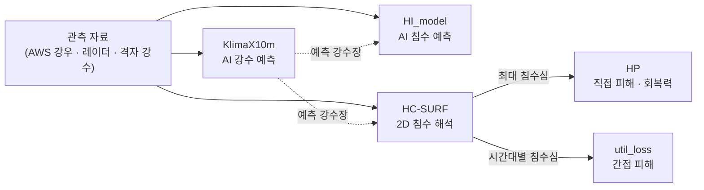

# 지능형도시홍수 연구성과

지능형 도시홍수 연구과제에서 개발한 **강수 예측 → 침수 예측·해석 → 피해·회복력 평가** 모형을 기관별로 공유하는 저장소입니다.
각 모형의 실행파일·소스·설명 자료는 해당 모형을 개발한 기관이 직접 올리고 관리합니다.

- 대상 지역: 서울 도림천 유역 (신림 배수분구 중심)
- 시간 해상도: 10분 단위

## 모형 목록

| 단계 | 모형 | 한 줄 설명 | 폴더 |
|---|---|---|---|
| 강수 예측 | **KlimaX10m** | ClimaX 기반 AI 초단기 강수 예측 (10분 간격, 최대 +3시간) | [models/KlimaX10m](models/KlimaX10m) |
| 침수 예측 | **HI_model** | 강우 시계열로 침수심 격자를 즉시 추론하는 AI 대리모형 | [models/HI_model](models/HI_model) |
| 침수 해석 | **HC-SURF** | 물리 기반 2차원 지표면 침수 해석 모형 | [models/HC-SURF](models/HC-SURF) |
| 피해 평가 | **HP** | 건물·도로 직접 피해 및 행정동별 회복력(4R) 평가 | [models/HP](models/HP) |
| 피해 평가 | **util_loss** | 산업 영업정지·정체에 따른 간접 피해액 산정 | [models/util_loss](models/util_loss) |

## 모형 간 연계



실선은 현재 연계되는 자료 흐름, 점선은 연계 예정인 흐름입니다.

## 저장소 구조

```
.
├── README.md            ← 이 문서
├── CONTRIBUTING.md      ← 기관별 자료 올리는 방법
└── models/
    ├── KlimaX10m/       ← 모형별 폴더 (담당 기관이 관리)
    ├── HI_model/
    ├── HC-SURF/
    ├── HP/
    └── util_loss/
```

## 자료를 올리려는 기관께

[CONTRIBUTING.md](CONTRIBUTING.md)에 올리는 순서와 폴더 구성, 대용량 파일 처리 방법을 정리해 두었습니다.
각 모형 폴더의 `README.md`에 있는 설명은 초안이므로, 담당 기관에서 자유롭게 고쳐 주시기 바랍니다.

## 이용 조건

각 모형의 저작권은 개발 기관에 있습니다. 이용 조건(라이선스)은 기관별 협의 후 모형 폴더에 명시할 예정이며,
명시되기 전까지는 담당 기관의 동의 없이 재배포하거나 상업적으로 이용할 수 없습니다.
