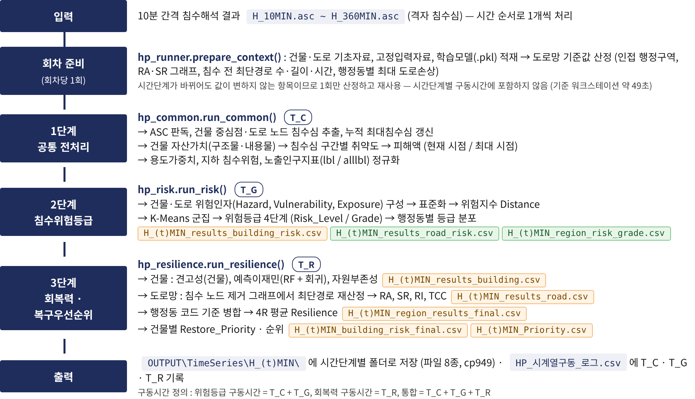
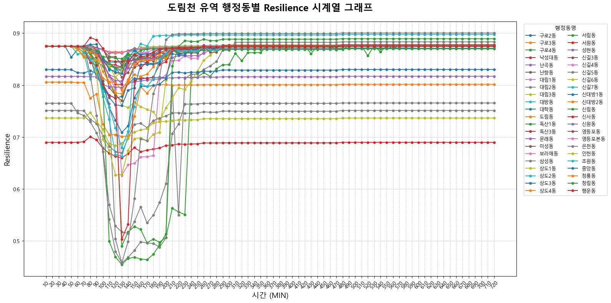
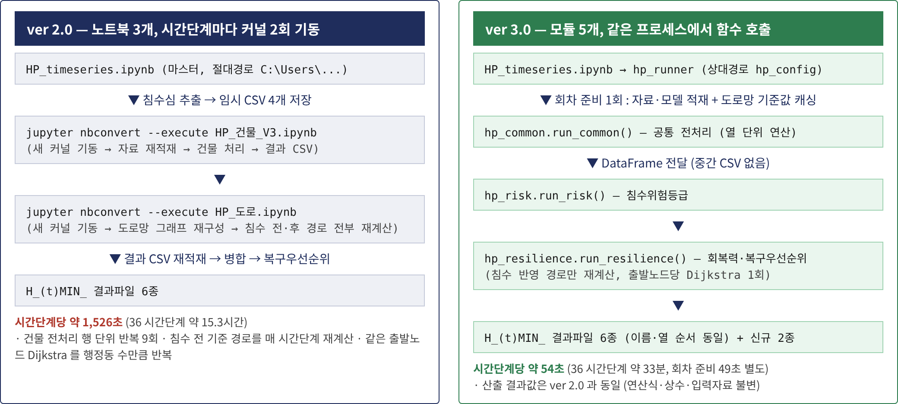

# HP — 침수 피해·회복력 평가 모형

| 항목 | 내용 |
|---|---|
| 담당 기관 | 홍익대학교 |
| 문의 | 이 저장소의 [Issues](https://github.com/GmoonYuk/IUF-Research-Outcomes/issues)에 남겨 주세요 (제목에 모형명 HP 를 적어 주세요) |
| 단계 | 피해 평가 |
| 최신 버전 | ver 3.0 (2026-11-13) |
| 구현 | Python 3.11 (pandas, geopandas, networkx, scikit-learn, joblib) |

이 문서는 **HP 모형 설명서 ver 3.0**(2026. 11. 13.)의 내용을 저장소 구성에 맞춰 옮긴 것입니다.
한글 문서 원본은 [`docs/HP 모형 설명서_ver_3.0.hwpx`](<docs/HP 모형 설명서_ver_3.0.hwpx>)에 있습니다.

- 입력: HC-SURF 의 시간대별 침수심 격자 (`H_10MIN.asc` ~ `H_360MIN.asc`, 10분 간격)
- 공간범위: 서울 도림천 유역 45개 행정동 (건물 59,998동, 도로 노드 4,018개)
- 시간 해상도: 10분 — 침수심 격자 1개(시간단계)마다 1회 구동
- 구동시간: 시간단계당 약 54초 (기준 워크스테이션, ver 2.0 은 약 1,526초)

## 목차

- [1. 개요](#1-개요)
- [2. 모형 코드 구조](#2-모형-코드-구조)
- [3. 모형 흐름도](#3-모형-흐름도)
- [4. 모형 입력자료](#4-모형-입력자료)
- [5. 모형 출력자료](#5-모형-출력자료)
- [6. 결과 표출](#6-결과-표출)
- [7. 실행 방법 및 환경](#7-실행-방법-및-환경)
- [8. ver 2.0 대비 변경사항](#8-ver-20-대비-변경사항)
- [9. 특이사항](#9-특이사항)
- [다른 모형과의 연계](#다른-모형과의-연계)
- [부록 A. 결과파일 열 설명](#부록-a-결과파일-열-설명)
- [부록 B. 고정입력자료 파일 목록](#부록-b-고정입력자료-파일-목록)
- [이용 조건](#이용-조건)

## 1. 개요

### 1.1 모형 개요

HP(Hyper Prioritization) 모형은 침수 해석 모형 HC-SURF 가 산출한 10분 간격 침수심 격자(ASC)를 입력으로 받아, 도림천 유역 45개 행정동의
**건물 객체·도로 노드별 침수위험등급**과 **행정동별 회복력(Resilience)**, **건물별 복구우선순위(Restore_Priority)** 를 산정하는 모형입니다.
침수 대응 골든타임과 복구 우선순위를 판단하는 근거 자료를 만드는 것이 목적입니다.
시간단계(10분)마다 아래 세 단계를 순차 수행하고 결과를 시간단계별 폴더에 저장합니다.

| 모듈 | 단계와 내용 | 주요 산출 |
|---|---|---|
| `hp_common.py` | **1단계 공통 전처리** — ASC 판독 → 건물 중심점·도로 노드 침수심 추출 → 자산가치·취약도·피해액, 용도가중치, 지하 침수위험, 노출인구지표 | `building_cur`, `building_max`, `road` (메모리) |
| `hp_risk.py` | **2단계 침수위험등급** — Hazard·Vulnerability·Exposure → 표준화 → 위험지수(Distance) → K-Means 군집 → 4단계 위험등급 | `results_building_risk`, `results_road_risk`, `region_risk_grade` |
| `hp_resilience.py` | **3단계 회복력·복구우선순위** — 견고성(건물)·예측이재민·자원부존성, 도로망 RA·SR·RI·TCC → Resilience → Restore_Priority | `results_building`, `results_road`, `region_results_final`, `building_risk_final`, `Priority` |

평가 항목은 다음과 같습니다.

- **건물 피해**: 구조·내용물 피해액, 침수 건물 수, 예측 이재민, 침수위험등급(4단계)
- **도로망 피해**: 도로 견고성(RI), 접근성(RA), 우회 가능성(SR), 교통 혼잡 비용(TCC), 도로 노드별 침수위험등급
- **지역 회복력**: 4R(Robustness · Rapidness · Redundancy · Resourcefulness) 기반 회복력 지수(Resilience), 건물별 복구우선순위

### 1.2 ver 3.0의 위치

ver 2.0 은 마스터 노트북 `HP_timeseries.ipynb` 가 시간단계마다 `HP_건물_V3.ipynb` 와 `HP_도로.ipynb` 를 `jupyter nbconvert` 로 별도 커널에서 실행하고
중간 CSV 로 자료를 주고받는 구조였습니다. ver 3.0 은 **연산식·상수·입력자료를 그대로 둔 채** 실행 구조만 단계별 Python 모듈로 재구성하고,
반복 연산을 정리하여 시간단계당 구동시간을 약 1,526초에서 약 54초로 줄인 버전입니다.
결과파일의 **이름과 열 순서는 ver 2.0 과 동일**하게 유지하였으므로, ver 2.0 결과를 읽던 연계 코드(결과 표출 코드, 플랫폼 연동 등)는 수정 없이 그대로 사용할 수 있습니다.

ver 3.0 코드는 2026년 9월 TTA R&D 결과검증시험(TC2 정확성, TC3 신속성)에 사용된 코드와 같은 것이며,
시험 당시 연구개발계획서 모형명(HG · HR)으로 나뉘어 있던 모듈·파일명을 HP 명칭과 ver 2.0 파일명으로 통일한 것입니다.
시험 산출물과 대조한 내용은 [8.4](#84-결과-동일성-검증)에 있습니다.

| 구분 | ver 2.0 (2026-04-30) | ver 3.0 (2026-11-13) |
|---|---|---|
| 코드 형태 | Jupyter 노트북 3개 | Python 모듈 5개 + 구동 노트북 1개 |
| 경로 | 절대경로 (`C:\Users\…`) | 폴더 기준 상대경로 (`hp_config.py`) |
| 구동시간 | 시간단계당 약 1,526초 | 시간단계당 약 54초 (최적화 전·후 산출물 일치) |
| 결과파일 | 6종 | 6종 동일 (이름·열 순서 유지) + 신규 2종 |

## 2. 모형 코드 구조


### 2.1 파일 구성

| 파일 (`src/`) | 역할 | ver 2.0 과 대응 |
|---|---|---|
| `hp_config.py` | 입력·출력 경로와 모형 파라미터. **경로를 바꿀 때는 이 파일만 수정**합니다. 경로는 파일 위치 기준 상대경로입니다. | 세 노트북 상단의 절대경로 변수 |
| `hp_common.py` | 1단계 공통 전처리: ASC 판독, 침수심 추출, 누적 최대침수심, 자산가치·취약도·피해액, 용도가중치, 지하 침수위험, 인구지표 | `HP_timeseries` 침수심 추출부 + `HP_건물_V3` 1~4단계 |
| `hp_risk.py` | 2단계 침수위험등급: 위험인자 구성, 표준화, 위험지수, K-Means 등급, 행정동별 등급 분포 | `HP_건물_V3` 등급 산정부 + `HP_도로` 노드 등급부 |
| `hp_resilience.py` | 3단계 회복력·복구우선순위: 견고성·예측이재민·자원부존성, 도로망 RA·SR·RI·TCC, Resilience, Restore_Priority | `HP_건물_V3` 회복력부 + `HP_도로` RA/SR/RI/TCC + `HP_timeseries` 의 `merge_results()` |
| `hp_runner.py` | 시간단계별 구동(`run_step`), 회차 준비(`prepare_context`), 단계별 소요시간 기록, 스크립트 실행 진입점(`run_timeseries`) | `HP_timeseries` 메인 반복문 |
| `HP_timeseries.ipynb` | 시계열 구동 노트북(운영용). 위에서부터 실행하면 ASC 폴더 전체를 구동합니다. | `HP_timeseries.ipynb` |
| `requirements.txt` | 검증된 라이브러리 버전 목록 | — |
| `analysis/HP_analysis1~3.ipynb` | 결과 표출 코드 (ver 2.0 과 동일) | `HP_analysis1~3.ipynb` |

### 2.2 폴더 구성

```
models/HP/
├── README.md                이 문서 (HP 모형 설명서 ver 3.0)
├── src/                     소스 코드
│   ├── hp_config.py  hp_common.py  hp_risk.py  hp_resilience.py  hp_runner.py
│   ├── HP_timeseries.ipynb  requirements.txt
│   └── analysis/            결과 표출 코드 (HP_analysis1~3.ipynb)
├── docs/
│   ├── HP 모형 설명서_ver_3.0.hwpx   설명서 원본 (한글 문서)
│   └── hp_*.png             이 문서에 쓰인 그림
└── sample/                  작은 예제 출력 (행정동 단위 결과)
```

설명서 원본(hwpx)의 폴더 구성은 기관 간 전달본(`HP_ver_3.0`) 기준입니다. 저장소와는 아래처럼 대응합니다.

| 전달본 (`HP_ver_3.0`) | 이 저장소 |
|---|---|
| `HP 코드/실시간(10분단위)코드/` 의 모듈·노트북 | `src/` |
| `HP 코드/` 의 결과 표출 코드 폴더 (노트북 3개) | `src/analysis/` |
| 결과 표출 코드 폴더의 `입력파일/` | `sample/region_results_final/` |
| 결과 표출 코드 폴더의 `결과그래프(예시)/` | `sample/analysis1_example.png` ~ `analysis3_example.png` |
| `HP 코드/` 의 시나리오 적용 코드 폴더 | 실시간 코드와 같은 코드이므로 따로 두지 않음 ([7.7](#77-경로-변경과-시나리오-적용) 참고) |
| `ASC_INPUT/`, `DEFAULT_BD/`, `DEFAULT_RD/` (입력자료) | 포함하지 않음 ([4절](#4-모형-입력자료) 참고) |
| `결과 파일(ver_3.0, …)/` | 행정동 단위 결과만 `sample/` 에 포함 |
| `결과 파일(ver_2.0, …)/` (참고용 ver 2.0 산출물) | 포함하지 않음 |

## 3. 모형 흐름도



### 3.1 단계별 처리 내용

**회차 준비** (`hp_runner.prepare_context` — 회차당 1회)

- 건물 기초자료(`sinrim building_depth_renew_updated.csv`), 도로 경계 노드 기초자료(`도림천유역_Boundary_updated.csv`), 고정입력자료 CSV, 학습모델(`.pkl`)을 메모리에 적재합니다.
- 도로망 기준값을 산정합니다: 인접 행정구역 목록, RA 그래프(통행시간 판정용)와 SR 그래프(중복성 판정용), 침수 전 기준 최단경로(0.172시간 이내 접근 경로 수, 경계 내 총 최단경로 수·길이·시간), 행정동별 최대 도로손상량. 이 값들은 도로망 링크자료와 노드의 행정동 코드에만 의존하므로 시간단계가 바뀌어도 변하지 않습니다.
- 누적 최대침수심 배열을 0 으로 초기화합니다. 새 회차(새 시계열)를 시작할 때는 `prepare_context()` 를 다시 호출하거나 `hp_common.reset_accumulator(ctx['S'])` 로 초기화합니다.

**1단계 공통 전처리** (`hp_common.run_common`)

- ASC 격자 침수심에서 건물 중심점(EPSG:5186)과 도로 노드 좌표의 침수심을 추출하고, 누적 최대침수심을 갱신합니다.
- 건물 용도·구조별 단가, 내용연수, 내용물가치비율, 1층 바닥고를 조회하여 구조물·내용물 자산가치를 산정하고(기준연도 2023 감가), 유효침수심(`f_depth`) 구간별 구조물·내용물 취약도를 적용하여 피해액을 산정합니다. 현재 시점(`depth`)과 최대 시점(`max_depth`) 두 벌을 만듭니다.
- 용도가중치(`weight_word`), 지하 침수위험(`under_risk`, (반)지하 주택에 한해 침수심·바닥면적 기반), 노출인구지표(`lbl` / `alllbl` 정규화)를 산정합니다.

**2단계 침수위험등급** (`hp_risk.run_risk`)

- 건물: Hazard = `weight_word` + `under_risk`, Vulnerability = `cont_vul`(내용물 취약도), Exposure = `alllbl`(노출인구). 도로 노드: Hazard = `WEIGHT`(침수심 기반 손상가중치), Vulnerability = `TI`(교통지표), Exposure = `LANES`(차로수).
- StandardScaler 로 표준화한 세 인자의 L2 노름을 위험지수 `Distance` 로 하고, 학습된 K-Means(4군집) 모형으로 군집을 예측한 뒤 군집 중심 오름차순으로 등급을 부여합니다: `Risk_Level`(매우낮음·낮음·위험·매우위험) 및 `Grade`(1~4).
- 행정동별 건물·도로 위험등급 분포를 집계합니다. 도로 노드의 `ROAD_DAMAGE`(= LANES × WEIGHT)와 `ROAD_DAMAGE_max` 는 3단계 RI 산정에 쓰입니다.

**3단계 회복력·복구우선순위** (`hp_resilience.run_resilience`)

- 견고성(건물) BI = (최대시점 피해액 합 − 현재시점 피해액 합) / 최대시점 피해액 합 (행정동별).
- 예측이재민: 행정동별 침수건물 수, 주택침수세대, 피해액 등 16개 변수를 표준화하여 Random Forest 로 예측하고, 판정 임계값(RF 예측 ≥ 1,349명 또는 침수건물 ≥ 161동 등)을 넘는 행정동은 다항회귀식 결과를 병용합니다. 자원부존성 = 1 − 예측이재민 / 대피소 수용가능인원 (0 이상으로 절단).
- 도로망: 통행 가능 수심(0.15 m)을 초과한 노드를 제거한 그래프에서 최단경로를 재산정하여 RA(0.172시간 이내 접근 경로 수 비율), SR(경계 내 최단경로 수 비율), RI(최대 도로손상 대비 현재 손상)를 구하고, 우회가 발생한 경로의 교통혼잡비용(TCC, 승용차·버스·화물차)을 산정합니다.
- 행정동 코드 기준으로 건물·도로 결과를 병합하여 Robustness = mean(견고성(건물), RI), Rapidness = RA, Redundancy = SR, Resourcefulness = 자원부존성, **Resilience = 4요소 평균** 을 산정합니다.
- 건물별 **Restore_Priority = Resilience × (1 − Distance/√3)**, `Restore_Priority_Rank` = 오름차순 밀집순위(dense rank).

### 3.2 구동시간 정의

러너는 시간단계마다 단계별 소요시간을 기록합니다.

- 위험등급 구동시간 = T_C + T_G (입력자료 1개 → 위험등급 산출 완료)
- 회복력 구동시간 = T_R (위험등급 산출물 → 회복력·복구우선순위 산출 완료)
- 통합 = T_C + T_G + T_R

회차 준비 시간(자료 적재 + 도로망 기준값)은 회차당 1회만 발생하므로 시간단계별 구동시간에 포함하지 않고 로그에 별도 열로 기록합니다.

## 4. 모형 입력자료

입력자료는 ver 2.0 과 동일하며, `hp_config.py` 의 상대경로로 참조합니다.

> **입력자료는 이 저장소에 포함하지 않았습니다.** 제3자 자료를 가공한 파일(건물 속성, 도로망, 행정동 통계)과 100MB 를 넘는 파일이 있기 때문입니다.
> 필요하시면 위 문의처(Issues)로 요청해 주세요. 받은 자료를 두는 위치는 [7.2](#72-입력자료-배치)에 있습니다.

### 4.1 침수해석 결과 ASC (시간단계별 입력)

침수 해석 모형 [HC-SURF](../HC-SURF) 가 산출하는 시간대별 침수심 격자입니다.

- **폴더 / 설정 변수**: `src/ASC_INPUT/Sillim_Results/` / `hp_config.ASC_INPUT_DIR`
- **파일**: `H_10MIN.asc` ~ `H_360MIN.asc` 36개 (2022-08-08 호우, 10분 간격 6시간). 파일명은 `H_` 로 시작하고 분 단위 숫자를 포함해야 하며, 숫자 오름차순으로 처리됩니다.
- **형식**: ESRI ASCII Grid — ncols 275, nrows 365, cellsize 10 m, 좌표계 EPSG:5186 (xllcorner 190785.2137, yllcorner 539737.4244), NODATA −9999 (침수심 0 으로 처리)
- **사용**: 건물 중심점(`Centroid_X_5186`, `Centroid_Y_5186`)과 도로 노드(x, y → EPSG:5186 변환) 위치의 격자 값을 침수심(m)으로 추출
- 격자 크기와 범위는 파일 머리말 6줄(ncols, nrows, xllcorner, yllcorner, cellsize, NODATA_value)에서 읽으므로, 좌표계가 같으면 크기나 해상도가 다른 격자도 읽습니다.
- 누적 최대침수심을 모형 안에서 시간 순서대로 갱신하므로, 한 강우 사상의 격자를 처음부터 순서대로 구동합니다.

### 4.2 건물계열 고정입력자료

`src/DEFAULT_BD/defaultdata/` 에 두는 21개 파일입니다.

| 파일 (사용 단계 · 규모) | 내용 |
|---|---|
| `sinrim building_depth_renew_updated.csv`<br>1단계 · 59,998행 × 15열 | 건물 기초자료: 용도(bdtyp)·구조(bdstr)·바닥면적·지하층수·사용승인연도·행정동·중심점 좌표·인구지표 |
| `adm_income(20240212).csv`<br>1단계 · 426행 × 7열 | 행정동별 가구소득(income) — 노출인구지표·EP 산정 |
| `building_cost.csv`<br>1단계 · 30행 × 2열 | 비주거용 건물 용도별 단위면적당 단가 |
| `house_cost.csv`<br>1단계 · 4행 × 2열 | 주거용 건물 구조별 단위면적당 단가 |
| `building_depreciation.csv`<br>1단계 · 30행 × 2열 | 비주거용 건물 용도별 내용연수 |
| `house_depreciation.csv`<br>1단계 · 4행 × 2열 | 주거용 건물 구조별 내용연수 |
| `building_csvr.csv`<br>1단계 · 31행 × 2열 | 용도별 내용물가치비율(CSVR) |
| `building_first_floor_elevation0.csv`<br>1단계 · 31행 × 2열 | 용도별 1층 바닥 높이 |
| `building_structure_vul.csv`<br>1단계 · 30행 × 13열 | 비주거용 건물 침수심 구간별 구조물 취약도 |
| `house_structure_vul.csv`<br>1단계 · 4행 × 13열 | 주거용 건물 구조별·침수심 구간별 구조물 취약도 |
| `building_content_vul_slope.csv`<br>1단계 · 31행 × 12열 | 내용물 취약도 기울기 파라미터(침수심 구간별) |
| `building_content_vul_b.csv`<br>1단계 · 31행 × 12열 | 내용물 취약도 절편 파라미터(침수심 구간별) |
| `building_weight.csv`<br>1·2단계 · 31행 × 3열 | 건물 용도별 가중치(weight_word) — Hazard 산정 |
| `building_03_depth.csv`<br>미사용 · 31행 × 3열 | (보조) 용도별 추가 침수심 자료 — 경로만 정의, 현재 연산에는 미사용 |
| `inputdata_2022_inputdata.csv`<br>3단계 · 424행 × 22열 | 행정동별 이재민 예측 입력 (고도·경사·면적·인구 등, 2022 서울시) |
| `서울시_이재민임시주거시설_amd.csv`<br>3단계 · 420행 × 9열 | 행정동별 대피소 수용가능인원 — 자원부존성 |

학습모델(`.pkl`) 5개는 scikit-learn 1.3.2 / joblib 로 저장된 객체이며, 같은 버전으로 적재해야 합니다.

| 파일 (사용 단계) | 내용 |
|---|---|
| `scaler.pkl`<br>2단계 | 건물 Hazard·Vulnerability·Exposure 표준화 스케일러(StandardScaler) |
| `kmeans_model.pkl`<br>2단계 | 건물 위험지수 군집모형(K-Means, 4군집) |
| `disaster_victims_prediction_model_RF.pkl`<br>3단계 | 예측이재민 Random Forest 회귀모형 |
| `regression_scaler.pkl`<br>3단계 | 예측이재민 입력 변수 표준화 스케일러 |
| `regression_equation_df.pkl`<br>3단계 | 예측이재민 다항회귀식 계수표(Term, Coefficient) |

### 4.3 도로계열 고정입력자료

`src/DEFAULT_RD/defaultdata2/` 에 두는 9개 파일입니다.

| 파일 (사용 단계 · 규모) | 내용 |
|---|---|
| `도림천유역_Boundary_updated.csv`<br>1·2·3단계 · 4,018행 × 15열 | 분석 대상 경계 내 도로 노드 기초자료: 좌표(WGS84), 행정동, 차로수(LANES), 교통지표(TI) 등 |
| `00.expanded_seoul_edges.csv`<br>3단계 · 196,573행 × 22열 | 서울시 도로 링크(Edge): F_NODE·T_NODE·LENGTH·MAX_SPD·설계교통량 — RA/SR 그래프 구성 |
| `00.seoul_nodes_with_centrality.csv`<br>3단계 · 66,983행 × 11열 | 서울시 도로 노드 전체와 행정동 코드 — 인접 행정구역 범위의 노드 추출 |
| `00.seoul_main_nodes_adm(20240507).csv`<br>3단계 · 1,169행 × 18열 | 주요 도로 노드 (RA 산정 출발노드) |
| `00.SIG.csv`<br>3단계 · 25행 × 26열 | 자치구 간 인접행렬 — 네트워크 탐색 범위 제한 |
| `nodes_to_remove.csv`<br>3단계 · 23,552행 × 1열 | SR 산정에서 제외할 노드 목록 |
| `도로별교통혼잡비용_0.csv`<br>3단계 · 513,144행 × 17열 | 경로별 침수 전·후 기준 경로 목록(Path_Name) — TCC 산정 대상 경로 판정 (약 225MB) |

| 파일 (사용 단계) | 내용 |
|---|---|
| `scaler.pkl`<br>2단계 | 도로 노드 Hazard·Vulnerability·Exposure 표준화 스케일러 |
| `kmeans_model.pkl`<br>2단계 | 도로 노드 위험지수 군집모형(K-Means, 4군집) |

### 4.4 ver 2.0과의 차이

- 입력자료의 내용·형식은 ver 2.0 과 같습니다. 차이는 참조 방식뿐입니다: 절대경로(`C:\Users\…\defaultdata\…`) → `hp_config.py` 의 상대경로.
- ver 2.0 이 시간단계마다 저장하던 임시 입력 CSV 4개(`…_updating.csv`, `sinrim4_max.csv`, `…_depth_2.csv` 등)는 ver 3.0 에서 만들지 않습니다. 자료는 메모리 상 DataFrame 으로 단계 간에 전달됩니다.

## 5. 모형 출력자료

### 5.1 결과 폴더 구조

결과는 `OUTPUT/TimeSeries/` 아래에 시간단계별 폴더로 저장됩니다(`hp_config.OUTPUT_ROOT`, 노트북의 `OUT_DIR` 로 변경 가능).
폴더명과 파일 접두어는 입력 ASC 파일명에서 `.asc` 를 뗀 이름(`H_10MIN` 등)입니다. 모든 CSV 는 ver 2.0 과 같이 **cp949** 인코딩입니다.

```
OUTPUT/TimeSeries/
├── H_10MIN/
│   ├── H_10MIN_results_building.csv          (ver 2.0 동일)
│   ├── H_10MIN_results_road.csv              (ver 2.0 동일)
│   ├── H_10MIN_results_building_risk.csv     (ver 2.0 동일 + Grade 열)
│   ├── H_10MIN_region_results_final.csv      (ver 2.0 동일)
│   ├── H_10MIN_building_risk_final.csv       (ver 2.0 동일 + Grade 열)
│   ├── H_10MIN_Priority.csv                  (ver 2.0 동일 + Grade 열)
│   ├── H_10MIN_results_road_risk.csv         (ver 3.0 신규)
│   └── H_10MIN_region_risk_grade.csv         (ver 3.0 신규)
├── H_20MIN/ … H_360MIN/
└── HP_시계열구동_로그.csv                      (단계별 소요시간, utf-8-sig)
```

### 5.2 결과파일별 내용

| 파일 (접두어 `H_(t)MIN_` 생략)<br>단위 · 열 수 · ver 2.0 대비 | 내용 |
|---|---|
| `results_building.csv`<br>행정동 · 11열 · 동일 | 피해액(천원), 재난복구지원금(천원), 예측이재민, 견고성(건물), 자원부존성, 건물 위험등급 분포(매우위험·위험·낮음·매우낮음) |
| `results_road.csv`<br>행정동 · 21열 · 동일 | 도로 노드 위험등급 분포, 0.172시간 이내 최단경로 수(침수 전·후), 경계 내 최단경로 수·길이·시간(침수 전·후), car/bus/truck_TCC, TCC, RA, SR, RI |
| `results_building_risk.csv`<br>건물 · 44열 · `Grade` 추가 | 기초자료 열 + 침수심(depth) + 자산가치·취약도·피해액 + 위험인자(Hazard, Vulnerability, Exposure) + Distance, Cluster, Risk_Level (+ Grade) |
| `region_results_final.csv`<br>행정동 · 37열 · 동일 | `results_building` 과 `results_road` 를 ADM_CD 기준 외부결합하고 Robustness, Rapidness, Redundancy, Resourcefulness, **Resilience** 를 붙인 것. 결과 표출 코드의 입력 |
| `building_risk_final.csv`<br>건물 · 47열 · `Grade` 추가 | `results_building_risk` 에 행정동 Resilience, **Restore_Priority**, Restore_Priority_Rank 를 붙인 것. 행 순서 = 건물 기초자료 순서 |
| `Priority.csv`<br>건물 · 47열 · `Grade` 추가 | `building_risk_final` 을 Restore_Priority_Rank 오름차순으로 정렬한 것 |
| `results_road_risk.csv`<br>도로 노드 · 25열 · **신규** | 노드 기초자료 + depth, WEIGHT(손상가중치), ROAD_DAMAGE_max, ROAD_DAMAGE, 위험인자, Distance, Cluster, Risk_Level, Grade |
| `region_risk_grade.csv`<br>행정동 · 10열 · **신규** | 건물 위험등급 분포 4열 + 도로 위험등급 분포 4열(도로_매우위험 등) |

### 5.3 ver 2.0 대비 차이

- **파일명·열 순서 유지**: ver 2.0 의 6종 파일은 이름과 열 순서가 완전히 같습니다. 열 위치로 읽는 기존 코드에 영향이 없습니다.
- **Grade 열 추가**: 위험등급을 숫자로 표기한 열(1 매우낮음 · 2 낮음 · 3 위험 · 4 매우위험)을 `results_building_risk`, `building_risk_final`, `Priority` 의 **맨 뒤**에 추가하였습니다. 문자열 열 `Risk_Level` 과 내용이 같습니다.
- **신규 파일 2종**: 도로 노드별 위험등급(`results_road_risk`)과 행정동별 건물·도로 등급 분포(`region_risk_grade`). ver 2.0 에서는 도로 노드별 등급이 파일로 남지 않았습니다.
- **Priority 의 동순위 행 순서**: ver 3.0 은 안정 정렬을 사용하여 같은 순위의 건물은 건물 기초자료 순서를 유지합니다. ver 2.0 은 기본 정렬이어서 동순위 행의 순서가 실행 환경에 따라 달라질 수 있었습니다. 값에는 차이가 없습니다.
- `region_results_final.csv` 의 열 구성(ADM_NM_x / ADM_NM_y 등 병합 접미사 포함)은 결과 표출 코드가 그대로 읽을 수 있도록 ver 2.0 과 동일하게 유지하였습니다.

### 5.4 구동 로그

`OUTPUT/TimeSeries/HP_시계열구동_로그.csv` 의 열은 다음과 같습니다.

| 열 | 내용 |
|---|---|
| `입력자료`, `시간단계_k` | ASC 파일명(접두어)과 시간단계 번호 |
| `T_C_공통전처리`, `T_G_위험등급`, `T_R_회복력` | 단계별 소요시간(초) |
| `T_R1_입력준비` ~ `T_R4_병합저장` | 3단계 내부 구간: 입력 준비 / 건물 회복력 / 도로망 분석 / 병합·저장 |
| `T_RISK_위험등급_구동시간`, `T_RES_회복력_구동시간`, `T_ALL_통합` | T_C+T_G, T_R, T_C+T_G+T_R |
| `위험등급_정상종료`, `회복력_정상종료`, `비고` | 정상종료(1)/실패(0) 및 필수 결과파일 생성 여부, 오류 메시지 |
| `회차준비_기초자료적재_s`, `회차준비_도로망기준값_s` | 회차당 1회 소요시간(모든 행에 같은 값) |

## 6. 결과 표출

결과 표출 코드(`src/analysis/HP_analysis1~3.ipynb`)는 ver 2.0 과 동일합니다.
세 노트북 모두 현재 폴더의 `H_*MIN_region_results_final.csv` 를 읽으므로(utf-8 → cp949 → euc-kr 순으로 인코딩 시도),
노트북을 결과 CSV 가 있는 폴더에서 실행하거나 CSV 를 노트북 폴더로 복사합니다.
`sample/region_results_final/` 에 ver 3.0 결과(36개 시간단계)의 `region_results_final.csv` 를 넣어 두었습니다.
제외 행정동 목록(`exclude_regions`)과 `HP_analysis3` 의 대상 행정동(`target_region`)은 노트북 상단에서 수정합니다.
그래프의 한글 글꼴은 Windows(Malgun Gothic)와 macOS(AppleGothic) 기준으로 지정되어 있습니다.

| 노트북 | 표출 내용 |
|---|---|
| `HP_analysis1.ipynb` | 행정동별·리드타임별 침수위험등급 그래프 — 기능상실률(1 − Resilience)의 시계열(로그 축)과 4단계 위험등급 구간. 전체 행정동 일괄 표출 |
| `HP_analysis2.ipynb` | 행정동별·리드타임별 Resilience 시계열 그래프. 시간 × 행정동 표를 `Resilience_Table_by_Time_Region.csv` 로 함께 저장. 전체 행정동 일괄 표출 |
| `HP_analysis3.ipynb` | 행정동별 회복력–피해액 연계 그래프 — 회복력과 누적 피해액의 시계열. 행정동별 개별 팝업 표출 |

**① HP_analysis1** — 행정동별·리드타임별 침수위험등급(기능상실률) 그래프


**② HP_analysis2** — 행정동별·리드타임별 Resilience 시계열 그래프



**③ HP_analysis3** — 행정동별 회복력–피해액 연계 그래프


예시 그림은 ver 2.0 의 12시간 모의 결과로 그린 것입니다.

## 7. 실행 방법 및 환경

### 7.1 실행 환경

| 항목 | 검증 버전 | 비고 |
|---|---|---|
| Python | 3.11 (64-bit) | 3.11.11 에서 검증. 3.10 ~ 3.12 범위에서 동작 |
| numpy / pandas | 1.26.4 / 2.2.3 | |
| geopandas (shapely, pyproj, pyogrio) | 1.1.2 | 도로 노드 좌표 변환(EPSG:4326 → 5186) |
| networkx | 3.4.2 | 최단경로(Dijkstra) |
| scikit-learn / joblib | **1.3.2** / 1.4.2 | 학습모델(`.pkl`) 저장 버전 — 반드시 맞춤 |
| jupyterlab, ipykernel, matplotlib | 4.x / 6.29 / 3.8 이상 | 노트북 실행 · 결과 표출 그래프 |
| OS | Windows 10/11 64-bit | Linux 에서도 동작 (경로 구분자 자동 처리) |

```bash
cd models/HP/src
pip install -r requirements.txt
```

### 7.2 입력자료 배치

`hp_config.py` 는 자기 위치(`src/`) 기준 상대경로로 입력자료를 찾습니다. 받은 입력자료를 아래처럼 두면 수정할 것이 없습니다.

```
src/
├── ASC_INPUT/Sillim_Results/     H_10MIN.asc ~ H_360MIN.asc
├── DEFAULT_BD/defaultdata/       건물계열 21개
└── DEFAULT_RD/defaultdata2/      도로계열 9개
```

### 7.3 노트북으로 구동 (운영용)

1. `src/` 폴더에서 JupyterLab 을 열고 `HP_timeseries.ipynb` 를 엽니다.
2. cell[1] 의 구동 조건을 확인합니다: `N_STEPS = None` (폴더 내 ASC 전체) / 숫자를 넣으면 앞에서부터 N개만, `N_JOBS = -1` (전체 논리코어).
3. 위에서부터 순서대로 실행(Run All)합니다. cell[2] 가 회차 준비(약 49초), cell[3] 이 시계열 구동(36 시간단계 약 33분, 기준 워크스테이션)입니다.
4. `OUTPUT/TimeSeries/H_(t)MIN/` 의 결과파일 8종과 `HP_시계열구동_로그.csv` 를 확인합니다. cell[4] 가 마지막 시간단계의 파일 목록과 행정동별 Resilience 를 표시합니다.

### 7.4 스크립트로 구동 (서비스 연계용)

```bash
# hp_config 의 ASC_INPUT_DIR 전체 구동
python hp_runner.py
# 입력 ASC 폴더와 결과 폴더를 지정하여 구동
python hp_runner.py <ASC 폴더> <결과 폴더>
```

### 7.5 함수로 호출 (플랫폼 내장용)

```python
import sys; sys.path.insert(0, "models/HP/src")
import hp_runner as runner

# 회차 시작 시 1회: 자료·모델 적재, 도로망 기준값 산정
ctx = runner.prepare_context()
# 'H_10MIN.asc', 'H_20MIN.asc', ... (숫자 오름차순)
for name in runner.list_asc_files():
    timing, result = runner.run_step(ctx, name, out_dir="OUTPUT/TimeSeries")
    # timing : 단계별 소요시간·정상종료 dict
    # result['risk']['building_risk']           : 건물별 위험등급 DataFrame
    # result['resilience']['region_resilience'] : 행정동별 Resilience DataFrame
    # result['resilience']['priority']          : 건물별 복구우선순위 DataFrame
```

`run_step(..., save=False)` 로 호출하면 파일을 쓰지 않고 DataFrame 만 반환합니다.
10분마다 ASC 1개가 도착하는 실시간 운영에서는 `prepare_context()` 를 서비스 기동 시 1회 수행하고, 파일이 도착할 때마다 `run_step()` 을 호출합니다.
누적 최대침수심은 `ctx['S']` 에 유지되므로 새 강우 사상(새 시계열)을 시작할 때 `hp_common.reset_accumulator(ctx['S'])` 를 호출합니다.

### 7.6 단계별 단독 실행 (확인용)

```bash
python hp_risk.py       ASC_INPUT/Sillim_Results/H_120MIN.asc OUTPUT/RISK
python hp_resilience.py ASC_INPUT/Sillim_Results/H_120MIN.asc OUTPUT/RESILIENCE
```

단독 실행은 해당 시간단계 1개만 처리하므로 누적 최대침수심이 그 시간단계의 침수심과 같습니다. 시계열 결과와 피해액·견고성 값이 다를 수 있습니다(확인용).

### 7.7 경로 변경과 시나리오 적용

경로는 `hp_config.py` 1절의 네 변수로 정합니다.

```python
_HERE = os.path.dirname(os.path.abspath(__file__))
ASC_INPUT_DIR = os.path.join(_HERE, "ASC_INPUT", "Sillim_Results")  # 10분 단위 ASC
DEFAULT_BD    = os.path.join(_HERE, "DEFAULT_BD", "defaultdata")      # 건물계열 자료
DEFAULT_RD    = os.path.join(_HERE, "DEFAULT_RD", "defaultdata2")     # 도로계열 자료
OUTPUT_ROOT   = os.path.join(_HERE, "OUTPUT")                          # 결과 폴더
```

- 실시간 운영에서 침수 해석 모형(HC-SURF)이 ASC 를 내려놓는 폴더를 쓰려면 `ASC_INPUT_DIR` 을 그 폴더의 절대경로로 바꿉니다(예: `ASC_INPUT_DIR = r"D:\HC-SURF\output"`). 나머지 모듈은 수정하지 않습니다.
- 시나리오(다른 강우 사상의 모의결과, 12시간 모의 등)를 적용할 때도 코드는 같고 `ASC_INPUT_DIR` 만 해당 ASC 폴더로 바꿉니다. 폴더 안의 `H_*.asc` 를 개수에 관계없이 모두 구동합니다.
- `hp_config.py` 4절의 모형 파라미터는 ver 2.0 과 같으며 변경하지 않습니다.

## 8. ver 2.0 대비 변경사항



### 8.1 구조 변경

- **같은 프로세스에서 함수 호출**: 시간단계마다 `jupyter nbconvert --execute` 로 두 노트북을 별도 커널에서 실행하던 것을 함수 호출로 바꾸었습니다. 커널 기동과 기초자료 재적재가 시간단계마다 반복되지 않습니다.
- **메모리 전달**: 단계 간 자료를 중간 CSV 대신 DataFrame 으로 전달합니다. 결과파일만 저장합니다.
- **상대경로**: 절대경로를 `hp_config.py` 의 폴더 기준 상대경로로 바꾸어 폴더째 옮겨도 수정이 필요 없습니다.

### 8.2 연산 최적화 (산출값 동일)

**① 건물 전처리 벡터화** — 공통 전처리 391초 → 0.5초

- ver 2.0: 건물 59,998동을 행 단위(iterrows)로 9회 순회하며 단가·내용연수 조회, 자산가치, 취약도, 피해액 산정
- ver 3.0: 조회·사칙연산을 열 단위(pandas/numpy) 연산으로 치환. 단독주택 행의 csvr·height 이월, 조회 실패 시 기존값 유지 등 원본의 세부 동작까지 재현

**② 도로망 기준값 캐싱** — 시간단계당 1,071초 제거 (회차당 1회 49초)

- ver 2.0: 인접 행정구역, RA·SR 그래프, 침수 전 기준 최단경로, 최대 도로손상을 매 시간단계 재계산
- ver 3.0: 침수 여부와 무관한 값이므로 회차 시작 시 1회만 산정(`build_road_baseline`)하고 재사용. 침수 반영 경로만 시간단계마다 계산

**③ RA 최단경로 중복 제거** — 도로망 분석 1,132초 → 47초

- ver 2.0: 같은 출발노드의 Dijkstra 를 행정동 수만큼 반복
- ver 3.0: 출발노드당 1회만 계산하고 행정동별 목적지 집합과 교집합(`_ra_group_counts`). 출발노드를 배치로 묶어 병렬 태스크에 전달

### 8.3 구동시간

기준 워크스테이션, 36 시간단계 기준입니다.

| 구간 | ver 2.0 (초/시간단계) | ver 3.0 (초/시간단계) | 비고 |
|---|---|---|---|
| T_C 공통 전처리 | 391.4 | 0.455 | ① |
| T_G 위험등급 | (T_C 에 포함) | 1.623 | |
| T_R 회복력 (도로망 분석 포함) | 1,132.4 | 51.557 | ②③ — 도로망 분석 47.4초 |
| **시간단계당 합계** | **약 1,526** | **약 54** | 약 28배 |
| 36 시간단계 소요 | 약 15.3시간 | 약 33분 + 회차 준비 49초 | 약 26배 |

ver 2.0 수치는 최적화 전 코드를 같은 입력으로 계측한 값이며, ver 3.0 수치는 2026-09-15 TC3 본시험(36 시간단계 × 3회차, 108/108 정상종료) 평균입니다.
도로망 분석은 joblib 병렬처리를 사용하므로 논리코어 수가 적은 환경에서는 회복력 단계 시간이 늘어납니다(2코어 환경 약 100초).

### 8.4 결과 동일성 검증

- 최적화 전·후 코드로 같은 입력(H_10MIN ~ H_30MIN)을 구동하여 산출물 17개 파일의 md5 가 모두 일치함을 확인하였습니다(2026-09).
- ver 3.0 명칭·파일명 정리 후, 검증된 36개 시간단계 산출물(TTA 시험 기준산출물)과 ver 3.0 코드 산출물을 H_10MIN · H_20MIN · H_30MIN 에 대해 대조하여 값·행·열이 모두 일치함을 확인하였습니다. `sample/` 의 예제 결과는 이 36개 시간단계 산출물을 ver 3.0 파일명·열 순서로 정리한 것에서 행정동 단위 파일만 뽑은 것입니다.
- TC2 정확성 시험 기준: 침수위험등급 인접등급 허용 일치율 89.38 %, 침수회복력 기능회복 단계 판별 정확도 83.48 % (모두 기준 80 % 이상 적합).

## 9. 특이사항

- 코드 경로는 전체적으로 **상대경로**입니다(ver 2.0 은 절대경로). 폴더 구조만 유지하면 드라이브 문자나 설치 위치와 무관하게 동작합니다.
- 입력자료(침수심 격자, 건물·도로망 기초자료, 학습모델)는 이 저장소에 넣지 않았습니다. 필요하시면 문의처로 요청해 주세요.
- 학습모델(`.pkl`)은 scikit-learn 1.3.2 로 저장되어 있습니다. 다른 버전에서는 적재 경고나 오류가 날 수 있으므로 `requirements.txt` 의 버전을 그대로 씁니다.
- 도로망 분석은 `n_jobs=-1` 로 전체 논리코어를 사용합니다. 같은 PC 에서 다른 무거운 작업과 동시에 돌리면 구동시간이 늘어납니다.
- 결과 CSV 인코딩은 cp949 이며, 행정동 병합 결과(`region_results_final`)에는 건물 자료가 없는 행정동(도로만 있는 경계 행정동)의 건물 열이 빈 값으로 남습니다. 이는 ver 2.0 과 같은 동작입니다.
- `Priority.csv` 의 동순위 행 순서는 ver 3.0 부터 건물 기초자료 순서로 고정됩니다(안정 정렬). 값은 ver 2.0 방식과 같습니다.
- `sample/` 에는 2022년 8월 8일 호우(36개 시간단계)를 ver 3.0 으로 구동한 결과 중 행정동 단위 파일만 넣었습니다. 내용은 [sample/README.md](sample/README.md)에 있습니다.

## 다른 모형과의 연계

- 입력은 [HC-SURF](../HC-SURF) 의 **시간대별 침수심 격자**(`H_10MIN.asc` ~ `H_360MIN.asc`)입니다. 최대 침수심 격자(`MAX_H.asc`)는 읽지 않으며, 누적 최대침수심은 모형 안에서 계산합니다.
- 형식(ESRI ASCII Grid, EPSG:5186)과 파일명 규칙(`H_<분>MIN.asc`)이 같으면 다른 침수 모형의 결과도 읽을 수 있습니다.

## 부록 A. 결과파일 열 설명

### A.1 건물 단위

`results_building_risk` / `building_risk_final` / `Priority`

| 열 | 산출 단계 · 내용 |
|---|---|
| `bdtyp`, `bdstr`, `bd_f_area`, `und_flo_cd`, `use_year`, `id`, `ADM_CD`, `ADM_NM`, `Centroid_X_5186`, `Centroid_Y_5186`, `gid`, `lbl`, `allgid`, `alllbl` | **입력** · 건물 기초자료: 용도, 구조, 바닥면적, 지하층수, 사용승인연도, 건물 ID, 행정동 코드·명, 중심점 좌표(EPSG:5186), 격자 ID 및 인구지표(lbl: 격자 인구, alllbl: 노출인구 — 격자 내 건물 수로 정규화) |
| `depth` | **1단계** · 해당 시간단계 침수심(m) |
| `지하코드`, `income` | **1단계** · 주거용(단독·다세대/연립·아파트) 여부(1/0), 행정동 가구소득 |
| `Damage_change`, `persisting_period`, `csvr`, `height`, `depreciation`, `st_value`, `cont_value` | **1단계** · 단가, 내용연수, 내용물가치비율, 1층 바닥고, 감가율, 구조물 가치, 내용물 가치 |
| `f_depth`, `str_vul`, `cont_vul`, `f_str_damage`, `f_cont_damage`, `total_value`, `f_total_damage` | **1단계** · 유효침수심(depth − height), 구조물·내용물 취약도, 구조물·내용물 피해액, 총 가치, 총 피해액 |
| `vul`, `T_weight`, `EP`, `PL`, `weight_word`, `under_risk` | **1단계** · 취약도 합, 시간가중치(침수 시 0 / 비침수 8), 노출인구 피해(EP), 인구 손실(PL), 용도가중치, 지하 침수위험(0~1) |
| `Hazard`, `Vulnerability`, `Exposure` | **2단계** · 위험인자 (Hazard = weight_word + under_risk, Vulnerability = cont_vul, Exposure = alllbl) |
| `Distance`, `Cluster`, `Risk_Level`, `Grade` | **2단계** · 위험지수(표준화 인자의 L2 노름, 군집 중심 범위로 절단), 군집번호(0~3), 위험등급명, 위험등급 번호(1~4) |
| `Resilience`, `Restore_Priority`, `Restore_Priority_Rank` | **3단계** · 소속 행정동의 Resilience, Resilience × (1 − Distance/√3), 오름차순 밀집순위 (`building_risk_final` / `Priority` 에만 있음) |

### A.2 행정동 단위

`results_building` / `results_road` / `region_results_final`

| 열 | 산출 단계 · 내용 |
|---|---|
| `ADM_CD`, `ADM_NM` (`ADM_NM_x`: 건물 측, `ADM_NM_y`: 도로 측) | 행정동 코드·명. `region_results_final` 은 외부결합이라 양쪽 명칭 열이 함께 남고 마지막에 `ADM_NM` 이 다시 붙습니다 |
| `피해액 (천원)`, `재난복구지원금 (천원)`, `예측이재민` | **3단계** · 침수건물(depth > 0.15 m) 내용물 피해액 합, 침수건물 수 × 3,000천원, RF/회귀 예측 이재민 수 |
| `견고성(건물)`, `자원부존성` | **3단계** · BI, 1 − 예측이재민/대피소 수용가능인원 |
| `매우위험`, `위험`, `낮음`, `매우낮음` (건물) / 도로 4열 | **2단계** · 행정동별 위험등급 분포(개수) |
| `0.172 이내 총 최단 경로 수`(`_flood`), `총_최단_경로_수`·`길이`·`시간`(`_flood`) | **회차 준비 / 3단계** · 침수 전 기준값과 침수 후(`_flood`) 값. RA·SR 의 분모·분자 |
| `car_TCC`, `bus_TCC`, `truck_TCC`, `TCC` | **3단계** · 차종별 교통혼잡비용과 합계(원, `TCC` 는 천 단위 구분 문자열) |
| `RA`, `SR`, `RI` | **3단계** · 신속성(접근 경로 비율), 중복성(최단경로 비율), 도로 견고성(손상 비율) — 소수 3자리 |
| `Robustness`, `Rapidness`, `Redundancy`, `Resourcefulness`, `Resilience` | **3단계** · mean(견고성(건물), RI), RA, SR, 자원부존성, 4요소 평균 |

### A.3 도로 노드 단위

`results_road_risk` (ver 3.0 신규)

| 열 | 내용 |
|---|---|
| `NODE_ID`, `y`, `x`, `street_cou`, `highway`, `ref`, `ADM_CD`, `ADM_NM`, `행정동`, `betweenness_centrality`, `LANES`, `TI`, `NM_won`, `NM` | 노드 기초자료: 좌표(WGS84), 연결 도로 수, 도로 등급, 행정동, 매개중심성, 차로수, 교통지표 등 |
| `depth`, `WEIGHT`, `ROAD_DAMAGE_max`, `ROAD_DAMAGE` | 침수심, 침수심 기반 손상가중치(0~1), 최대 손상(LANES), 현재 손상(LANES × WEIGHT) |
| `Hazard`, `Vulnerability`, `Exposure`, `Distance`, `Cluster`, `Risk_Level`, `Grade` | 위험인자(WEIGHT, TI, LANES), 위험지수, 군집, 위험등급명, 위험등급 번호 |

## 부록 B. 고정입력자료 파일 목록

각 파일의 규모와 열 이름 전체를 정리한 것입니다(ver 2.0 과 동일한 파일).

<details>
<summary>파일별 열 이름 (펼치기)</summary>

건물계열 — `DEFAULT_BD/defaultdata/` (21개)

| 파일 · 규모 | 열 이름 |
|---|---|
| `sinrim building_depth_renew_updated.csv`<br>59,998행 × 15열 | `bdtyp`, `bdstr`, `bd_f_area`, `und_flo_cd`, `use_year`, `id`, `ADM_CD`, `ADM_NM`, `Centroid_X_5186`, `Centroid_Y_5186`, `depth`, `gid`, `lbl`, `allgid`, `alllbl` |
| `adm_income(20240212).csv`<br>426행 × 7열 | `ADM_CD`, `ADM_NM`, `평균_공시지가`, `등분`, `income_0`, `income` + 이름 없는 열 1개 |
| `building_cost.csv`<br>30행 × 2열 | `occupancy`, `costs` |
| `house_cost.csv`<br>4행 × 2열 | `description`, `costs` |
| `building_depreciation.csv`<br>30행 × 2열 | `occupancy`, `persisting_period` |
| `house_depreciation.csv`<br>4행 × 2열 | `description`, `persisting_period` |
| `building_csvr.csv`<br>31행 × 2열 | `occupancy`, `csvr` |
| `building_first_floor_elevation0.csv`<br>31행 × 2열 | `occupancy`, `height` |
| `building_structure_vul.csv`<br>30행 × 13열 | `occupancy`, `0m`, `0-0.3m`, `0.3-0.6m`, `0.6-0.9m`, `0.9-1.2m`, `1.2-1.5m`, `1.5-1.8m`, `1.8-2.1m`, `2.1-2.4m`, `2.4-2.7m`, `2.7-3.0m`, `3.0m-` |
| `house_structure_vul.csv`<br>4행 × 13열 | `description`, `0m`, `0-0.3m`, `0.3-0.6m`, `0.6-0.9m`, `0.9-1.2m`, `1.2-1.5m`, `1.5-1.8m`, `1.8-2.1m`, `2.1-2.4m`, `2.4-2.7m`, `2.7-3.0m`, `3.0m-` |
| `building_content_vul_slope.csv`<br>31행 × 12열 | `occupancy`, `0m`, `0-0.3m`, `0.3-0.6m`, `0.6-0.9m`, `0.9-1.2m`, `1.2-1.5m`, `1.5-1.8m`, `1.8-2.1m`, `2.1-2.4m`, `2.4-2.7m`, `2.7-3.0m` |
| `building_content_vul_b.csv`<br>31행 × 12열 | `occupancy`, `0m`, `0-0.3m`, `0.3-0.6m`, `0.6-0.9m`, `0.9-1.2m`, `1.2-1.5m`, `1.5-1.8m`, `1.8-2.1m`, `2.1-2.4m`, `2.4-2.7m`, `2.7-3.0m` |
| `building_weight.csv`<br>31행 × 3열 | `occupancy`, `weight`, `weight_word` |
| `building_03_depth.csv`<br>31행 × 3열 | `occupancy`, `depth`, `손상정도` |
| `inputdata_2022_inputdata.csv`<br>424행 × 22열 | `ADM_CD`, `구`, `행정동`, `연도`, `사망 (명)`, `이재민 (명)`, `평균고도`, `평균경사`, `침수건물`, `주택침수세대 (세대)`, `주택피해액 (천원)`, `피해액 (천원)`, `(반)지하주택침수세대 (세대)`, `100`, `200`, `300`, `400`, `500`, `600`, `700`, `면적`, `인구수(명)` |
| `서울시_이재민임시주거시설_amd.csv`<br>420행 × 9열 | `ADM_CD`, `ADM_NM`, `수용가능인원수` + 이름 없는 열 6개 |
| `scaler.pkl`<br>724 B | 학습모델 객체 (joblib) |
| `kmeans_model.pkl`<br>5 KB | 학습모델 객체 (joblib) |
| `disaster_victims_prediction_model_RF.pkl`<br>1.0 MB | 학습모델 객체 (joblib) |
| `regression_scaler.pkl`<br>679 B | 학습모델 객체 (joblib) |
| `regression_equation_df.pkl`<br>7 KB | 학습모델 객체 (joblib) |

도로계열 — `DEFAULT_RD/defaultdata2/` (9개)

| 파일 · 규모 | 열 이름 |
|---|---|
| `도림천유역_Boundary_updated.csv`<br>4,018행 × 15열 | `NODE_ID`, `y`, `x`, `street_cou`, `highway`, `ref`, `ADM_CD`, `ADM_NM`, `행정동`, `betweenness_centrality`, `LANES`, `TI`, `NM_won`, `NM`, `depth` |
| `00.expanded_seoul_edges.csv`<br>196,573행 × 22열 | `T_NODE`, `F_NODE`, `key`, `LINK_ID`, `name`, `highway`, `oneway`, `reversed`, `LENGTH`, `lanes`, `ref`, `bridge`, `MAX_SPD`, `tunnel`, `junction`, `access`, `width`, `service`, `일평균교통량`, `설계시간 계수`, `설계교통량` + 이름 없는 열 1개 |
| `00.seoul_nodes_with_centrality.csv`<br>66,983행 × 11열 | `NODE_ID`, `y`, `x`, `street_cou`, `highway`, `ref`, `ADM_CD`, `ADM_NM`, `행정동`, `LANES`, `betweenness_centrality` |
| `00.seoul_main_nodes_adm(20240507).csv`<br>1,169행 × 18열 | `NODE_ID`, `y`, `x`, `street_cou`, `highway`, `ref`, `ADM_CD`, `ADM_NM`, `행정동`, `emd_cd`, `li_cd`, `mntn_yn`, `lnbr_mnnm`, `lnbr_slno`, `buld_nm_dc`, `mat_res`, `id`, `HubDist` |
| `00.SIG.csv`<br>25행 × 26열 | `ADM_CD`, `11010`, `11020`, `11030`, `11040`, `11050`, `11060`, `11070`, `11080`, `11090`, `11100`, `11110`, `11120`, `11130`, `11140`, `11150`, `11160`, `11170`, `11180`, `11190`, `11200`, `11210`, `11220`, `11230`, `11240`, `11250` |
| `nodes_to_remove.csv`<br>23,552행 × 1열 | `NODE_ID` |
| `도로별교통혼잡비용_0.csv`<br>513,144행 × 17열 | `Group_before`, `Path_Name`, `Path_before`, `Length_before`, `Time_before`, `Speed_ave_before`, `Average_Amount`, `Group_after`, `Path_after`, `Length_after`, `Time_after`, `Speed_ave_after`, `Start_Node`, `Destination_Node`, `car_TCC`, `bus_TCC`, `truck_TCC` |
| `scaler.pkl`<br>723 B | 학습모델 객체 (joblib) |
| `kmeans_model.pkl`<br>1 KB | 학습모델 객체 (joblib) |

</details>

## 이용 조건

이 모형의 저작권은 개발 기관(홍익대학교)에 있습니다. 이용 조건(라이선스)은 기관 협의 후 이 폴더에 명시할 예정이며,
명시되기 전까지는 담당 기관의 동의 없이 재배포하거나 상업적으로 이용할 수 없습니다.
