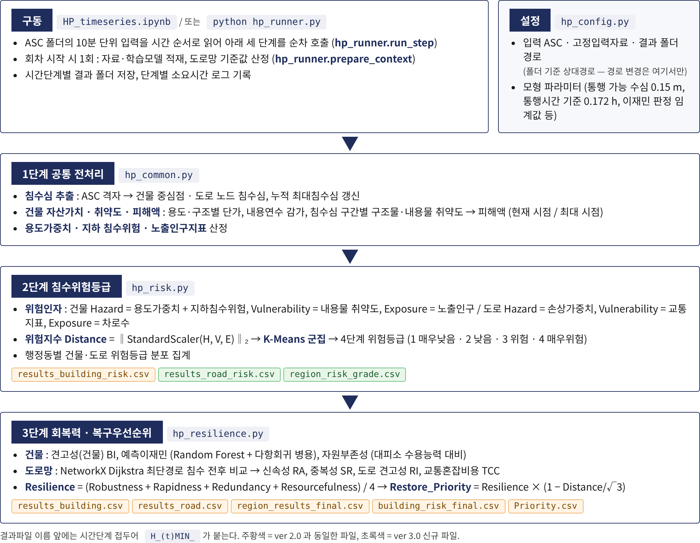
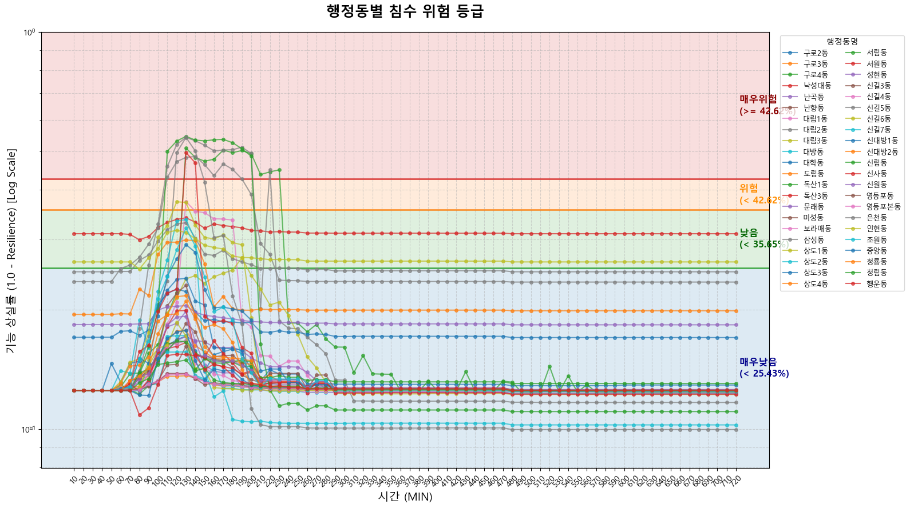
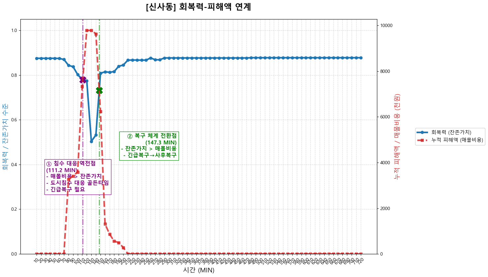

# HP — 침수 피해·회복력 평가 모형

| 항목 | 내용 |
|---|---|
| 담당 기관 | 홍익대학교 |
| 문의 | 이 저장소의 [Issues](https://github.com/GmoonYuk/IUF-Research-Outcomes/issues)에 남겨 주세요 (제목에 모형명 HP 를 적어 주세요) |
| 단계 | 피해 평가 |
| 최신 버전 | ver 3.0 (2026-11-13) |
| 구현 | Python 3.11 (pandas, geopandas, networkx, scikit-learn, joblib) |

## 개요

HP(Hyper Prioritization) 모형은 침수 해석 결과(10분 간격 침수심 격자)를 받아 건물과 도로의 직접 피해와 침수위험등급을 산정하고,
행정동 단위의 도시 회복력(4R)과 건물별 복구 우선순위를 평가하는 모형입니다.
침수 대응 골든타임과 복구 우선순위를 판단하는 근거 자료를 만드는 것이 목적입니다.

- 대상 지역: 서울 도림천 유역 45개 행정동 (건물 59,998동, 도로 노드 4,018개)
- 시간 해상도: 10분 — 침수심 격자 1개(시간단계)마다 1회 구동하고 결과를 시간단계별 폴더에 저장합니다.
- 구동시간: 시간단계당 약 54초 (기준 워크스테이션, ver 2.0 은 약 1,526초)

## 평가 항목

| 영역 | 산출물 |
|---|---|
| 건물 피해 | 구조·내용물 피해액, 침수 건물 수, 예측 이재민, 침수위험등급(4단계) |
| 도로망 피해 | 도로 견고성(RI), 접근성(RA), 우회 가능성(SR), 교통 혼잡 비용(TCC), 도로 노드별 침수위험등급 |
| 지역 회복력 | 4R(Robustness · Rapidness · Redundancy · Resourcefulness) 기반 회복력 지수(Resilience), 건물별 복구 우선순위 |

## 폴더 구성

```
models/HP/
├── README.md                이 문서
├── src/                     소스 코드 (ver 3.0)
│   ├── hp_config.py         입력·출력 경로, 모형 파라미터 (경로는 이 파일에서만 바꿉니다)
│   ├── hp_common.py         1단계 공통 전처리
│   ├── hp_risk.py           2단계 침수위험등급
│   ├── hp_resilience.py     3단계 회복력·복구우선순위
│   ├── hp_runner.py         시계열 구동 러너 (스크립트 실행 진입점)
│   ├── HP_timeseries.ipynb  시계열 구동 노트북
│   ├── requirements.txt     검증된 라이브러리 버전
│   └── analysis/            결과 표출 코드 (HP_analysis1~3.ipynb)
├── docs/
│   ├── HP 모형 설명서_ver_3.0.hwpx   모형 설명서 (한글 문서)
│   └── hp_*.png             이 문서에 쓰인 그림
└── sample/                  작은 예제 출력 (행정동 단위 결과)
```

## 처리 흐름


| 단계 | 모듈 | 내용 |
|---|---|---|
| 회차 준비 (회차당 1회) | `hp_runner.prepare_context()` | 기초자료·학습모델 적재, 도로망 기준값(침수 전 최단경로 등) 산정 |
| 1단계 공통 전처리 | `hp_common.py` | 침수심 격자에서 건물 중심점·도로 노드 침수심 추출, 누적 최대침수심 갱신, 건물 자산가치·취약도·피해액 산정 |
| 2단계 침수위험등급 | `hp_risk.py` | 위험인자(Hazard · Vulnerability · Exposure) → 위험지수(Distance) → K-Means 군집 → 4단계 등급 |
| 3단계 회복력·복구우선순위 | `hp_resilience.py` | 건물 견고성·예측 이재민·자원부존성, 도로망 RA·SR·RI·TCC → Resilience → 건물별 복구 우선순위 |

주요 산정식은 다음과 같습니다.

- 위험지수 `Distance` = ‖StandardScaler(Hazard, Vulnerability, Exposure)‖₂ → K-Means(4군집) → 위험등급 1 매우낮음 · 2 낮음 · 3 위험 · 4 매우위험
- `Resilience` = (Robustness + Rapidness + Redundancy + Resourcefulness) / 4
  - Robustness = mean(견고성(건물), RI), Rapidness = RA, Redundancy = SR, Resourcefulness = 자원부존성
- `Restore_Priority` = Resilience × (1 − Distance / √3)

코드 구조는 아래 그림과 같습니다.



## 입력

### 1) 침수심 격자 (시간단계별)

- 형식: ESRI ASCII Grid, 좌표계 EPSG:5186, 단위 m. NODATA 는 침수심 0 으로 처리합니다.
- 파일명: `H_<분>MIN.asc` (예: `H_10MIN.asc` ~ `H_360MIN.asc`). `H_` 로 시작하는 파일을 분 단위 숫자 순으로 모두 읽습니다.
- 격자 크기와 범위는 파일 머리말(header)에서 읽으므로 해상도에 제한이 없습니다(예제 자료는 10m, 275 × 365 격자).
- 누적 최대침수심을 모형 안에서 시간 순서대로 갱신하므로, 한 강우 사상의 격자를 처음부터 순서대로 구동합니다.

### 2) 고정 입력자료

건물·도로망 기초자료, 단가·취약도 조회표, 학습모델(`.pkl`)로 이루어진 30개 파일입니다.

> **입력자료는 이 저장소에 포함하지 않았습니다.** 제3자 자료를 가공한 파일(건물 속성, 도로망, 행정동 통계)과 100MB 를 넘는 파일이 있기 때문입니다.
> 필요하시면 위 문의처(Issues)로 요청해 주세요.

<details>
<summary>고정 입력자료 목록 (펼치기)</summary>

건물계열 — `DEFAULT_BD/defaultdata/` (21개)

| 파일 | 내용 | 규모 |
|---|---|---|
| `sinrim building_depth_renew_updated.csv` | 건물 기초자료 (용도·구조·바닥면적·지하층·사용승인연도·행정동·중심점 좌표·인구지표) | 59,998행 × 15열 |
| `adm_income(20240212).csv` | 행정동별 가구소득 | 426행 × 7열 |
| `building_cost.csv`, `house_cost.csv` | 건물 용도별·주택 구조별 단위면적당 단가 | 30행, 4행 |
| `building_depreciation.csv`, `house_depreciation.csv` | 건물 용도별·주택 구조별 내용연수 | 30행, 4행 |
| `building_csvr.csv` | 용도별 내용물가치비율 | 31행 |
| `building_first_floor_elevation0.csv` | 용도별 1층 바닥 높이 | 31행 |
| `building_structure_vul.csv`, `house_structure_vul.csv` | 침수심 구간별 구조물 취약도 | 30행, 4행 |
| `building_content_vul_slope.csv`, `building_content_vul_b.csv` | 침수심 구간별 내용물 취약도 기울기·절편 | 31행, 31행 |
| `building_weight.csv` | 건물 용도별 가중치 | 31행 |
| `building_03_depth.csv` | 보조 자료 (현재 연산에는 쓰지 않음) | 31행 |
| `inputdata_2022_inputdata.csv` | 행정동별 이재민 예측 입력 (고도·경사·면적·인구 등) | 424행 × 22열 |
| `서울시_이재민임시주거시설_amd.csv` | 행정동별 대피소 수용가능인원 | 420행 |
| `scaler.pkl`, `kmeans_model.pkl` | 건물 위험지수 표준화·군집 모형 | — |
| `disaster_victims_prediction_model_RF.pkl`, `regression_scaler.pkl`, `regression_equation_df.pkl` | 예측 이재민 모형 (Random Forest, 다항회귀) | — |

도로계열 — `DEFAULT_RD/defaultdata2/` (9개)

| 파일 | 내용 | 규모 |
|---|---|---|
| `도림천유역_Boundary_updated.csv` | 대상 경계 안 도로 노드 (좌표·행정동·차로수·교통지표) | 4,018행 × 15열 |
| `00.expanded_seoul_edges.csv` | 서울시 도로 링크 (길이·제한속도·설계교통량) | 196,573행 × 22열 |
| `00.seoul_nodes_with_centrality.csv` | 서울시 도로 노드와 행정동 코드 | 66,983행 × 11열 |
| `00.seoul_main_nodes_adm(20240507).csv` | 주요 도로 노드 (접근성 RA 산정의 출발 노드) | 1,169행 × 18열 |
| `00.SIG.csv` | 자치구 인접행렬 | 25행 × 26열 |
| `nodes_to_remove.csv` | 우회 가능성 SR 산정에서 제외할 노드 | 23,552행 |
| `도로별교통혼잡비용_0.csv` | 경로별 기준 경로 목록 (교통 혼잡 비용 산정 대상 판정), 약 225MB | 513,144행 × 17열 |
| `scaler.pkl`, `kmeans_model.pkl` | 도로 노드 위험지수 표준화·군집 모형 | — |

</details>

## 출력

시간단계마다 `OUTPUT/TimeSeries/H_<분>MIN/` 폴더에 아래 8개 파일을 저장합니다. 인코딩은 cp949 입니다.

| 파일 (접두어 `H_<분>MIN_` 생략) | 단위 | 내용 |
|---|---|---|
| `results_building.csv` | 행정동 | 피해액, 재난복구지원금, 예측 이재민, 견고성(건물), 자원부존성, 건물 위험등급 분포 |
| `results_road.csv` | 행정동 | 도로 노드 위험등급 분포, 침수 전·후 최단경로 수·길이·시간, TCC, RA, SR, RI |
| `results_building_risk.csv` | 건물 | 침수심, 자산가치·취약도·피해액, 위험인자, Distance, Risk_Level, Grade |
| `region_results_final.csv` | 행정동 | 위 두 행정동 결과를 합치고 Robustness·Rapidness·Redundancy·Resourcefulness·**Resilience** 를 붙인 것 |
| `building_risk_final.csv` | 건물 | `results_building_risk` 에 Resilience·**Restore_Priority**·순위를 붙인 것 (건물 기초자료 순서) |
| `Priority.csv` | 건물 | `building_risk_final` 을 복구 우선순위 순으로 정렬한 것 |
| `results_road_risk.csv` | 도로 노드 | 침수심, 손상가중치, 도로 손상, 위험인자, Distance, Risk_Level, Grade (ver 3.0 신규) |
| `region_risk_grade.csv` | 행정동 | 건물·도로 위험등급 분포 (ver 3.0 신규) |

- 앞의 6개 파일은 ver 2.0 과 파일명·열 순서가 같습니다. 건물 단위 3개 파일에는 위험등급 번호 `Grade`(1~4) 열이 맨 뒤에 추가되었습니다.
- 구동 로그 `OUTPUT/TimeSeries/HP_시계열구동_로그.csv` 에 시간단계별·단계별 소요시간을 기록합니다.
- 열(column) 설명은 설명서 부록 A 에 있습니다.

## 실행 환경

| 항목 | 검증 버전 |
|---|---|
| Python | 3.11 (64-bit) |
| numpy / pandas | 1.26.4 / 2.2.3 |
| geopandas / networkx | 1.1.2 / 3.4.2 |
| scikit-learn / joblib | **1.3.2** / 1.4.2 |

학습모델(`.pkl`)이 scikit-learn 1.3.2 로 저장되어 있으므로 scikit-learn 버전은 맞춰 주세요.
도로망 분석은 joblib 병렬처리로 전체 논리코어를 사용합니다.

```bash
cd models/HP/src
pip install -r requirements.txt
```

## 실행 방법

### 1) 입력자료 배치

`hp_config.py` 는 자기 위치(`src/`) 기준 상대경로로 입력자료를 찾습니다. 받은 입력자료를 아래처럼 두면 수정할 것이 없습니다.

```
src/
├── ASC_INPUT/Sillim_Results/     H_10MIN.asc ~ H_360MIN.asc
├── DEFAULT_BD/defaultdata/       건물계열 21개
└── DEFAULT_RD/defaultdata2/      도로계열 9개
```

다른 위치의 자료를 쓰려면 `hp_config.py` 1절의 `ASC_INPUT_DIR`, `DEFAULT_BD`, `DEFAULT_RD`, `OUTPUT_ROOT` 만 바꿉니다.
예를 들어 다른 강우 사상(시나리오)이나 12시간 모의 결과를 돌릴 때는 `ASC_INPUT_DIR` 만 해당 격자 폴더로 바꾸면 됩니다.

### 2) 노트북으로 구동

`src/HP_timeseries.ipynb` 를 열어 위에서부터 실행합니다(Run All). 입력 폴더의 격자 전체를 시간 순서로 구동합니다.

### 3) 스크립트로 구동

```bash
python hp_runner.py                          # hp_config 의 ASC_INPUT_DIR 전체
python hp_runner.py <격자 폴더> <결과 폴더>    # 폴더 지정
```

### 4) 함수로 호출 (다른 시스템에 내장할 때)

```python
import hp_runner as runner

ctx = runner.prepare_context()                  # 회차 시작 시 1회
for name in runner.list_asc_files():            # 'H_10MIN.asc', 'H_20MIN.asc', ...
    timing, result = runner.run_step(ctx, name, out_dir="OUTPUT/TimeSeries")
    # result['risk']['building_risk']            건물별 위험등급 (DataFrame)
    # result['resilience']['region_resilience']  행정동별 Resilience (DataFrame)
    # result['resilience']['priority']           건물별 복구 우선순위 (DataFrame)
```

`run_step(..., save=False)` 로 호출하면 파일을 쓰지 않고 DataFrame 만 돌려줍니다.
누적 최대침수심은 `ctx` 안에 유지되므로, 새 강우 사상을 시작할 때는 `prepare_context()` 를 다시 호출하거나 `hp_common.reset_accumulator(ctx['S'])` 로 초기화합니다.

### 5) 단계별 단독 실행 (확인용)

```bash
python hp_risk.py        <격자 파일> [결과 폴더]
python hp_resilience.py  <격자 파일> [결과 폴더]
```

## 결과 표출

`src/analysis/` 의 노트북 3개는 현재 폴더의 `H_*MIN_region_results_final.csv` 를 읽어 그래프를 그립니다.
결과 CSV 를 노트북과 같은 폴더에 복사하거나, 노트북 위쪽의 `file_pattern` 을 결과 폴더 경로로 바꿔 실행합니다.
예제 자료는 `sample/region_results_final/` 에 있습니다.

| 노트북 | 내용 |
|---|---|
| `HP_analysis1.ipynb` | 행정동별 기능 상실률(1 − Resilience) 시계열과 침수 위험 등급 구간 (전체 행정동 일괄 표출) |
| `HP_analysis2.ipynb` | 행정동별 Resilience 시계열 (전체 행정동 일괄 표출), 시간 × 행정동 표를 CSV 로 저장 |
| `HP_analysis3.ipynb` | 행정동 한 곳의 회복력–누적 피해액 연계 그래프 (침수 대응 역전점, 복구 체계 전환점). 대상 행정동은 `target_region` 으로 지정 |





## 예제

`sample/` 에 2022년 8월 8일 호우(10분 간격 6시간, 36개 시간단계)를 ver 3.0 으로 구동한 결과 중 행정동 단위 파일을 넣어 두었습니다.
자세한 내용은 [sample/README.md](sample/README.md)를 보세요.

## 다른 모형과의 연계

- 입력으로 HC-SURF 의 **시간대별 침수심 격자**(`H_10MIN.asc` ~ `H_360MIN.asc`)를 사용합니다. 최대 침수심 격자(`MAX_H.asc`)는 읽지 않으며, 누적 최대침수심은 모형 안에서 계산합니다.
- 형식(ESRI ASCII Grid, EPSG:5186)과 파일명 규칙(`H_<분>MIN.asc`)이 같으면 다른 침수 모형의 결과도 입력으로 쓸 수 있습니다.

## 버전 이력

| 버전 | 주요 내용 |
|---|---|
| ver 2.0 (2026-04) | 대상 지역을 도림천 유역 45개 행정동으로 확장, 10분 단위 침수심 격자를 차례로 읽는 시계열 구동 (노트북 3개 구성) |
| ver 3.0 (2026-11) | 단계별 Python 모듈 5개로 재구성, 폴더 기준 상대경로, 구동시간 단축, 결과파일 2종 추가 |

ver 3.0 은 ver 2.0 의 연산식·상수·입력자료를 그대로 두고 실행 구조와 속도만 바꾼 버전입니다. 같은 입력으로 구동한 최적화 전·후 산출물이 일치함을 확인했습니다.


- 시간단계마다 노트북 두 개를 별도 커널로 실행하고 중간 CSV 로 자료를 주고받던 구조를, 한 프로세스 안의 함수 호출로 바꾸었습니다.
- 건물 전처리의 행 단위 반복을 열 단위 연산으로 바꾸었습니다.
- 침수 여부와 무관한 도로망 기준값(침수 전 최단경로 등)을 회차당 1회만 산정합니다.
- 접근성(RA) 산정에서 같은 출발 노드의 최단경로를 행정동 수만큼 반복하던 것을 1회로 줄였습니다.

| 구간 (시간단계당) | ver 2.0 | ver 3.0 |
|---|---|---|
| 공통 전처리 | 391.4초 | 0.5초 |
| 위험등급 | (전처리에 포함) | 1.6초 |
| 회복력 (도로망 분석 포함) | 1,132.4초 | 51.6초 |
| 합계 | 약 1,526초 | 약 54초 |
| 36개 시간단계 | 약 15.3시간 | 약 33분 (회차 준비 49초 별도) |

ver 3.0 값은 기준 워크스테이션에서 36개 시간단계를 3회 반복 구동한 평균이고(2026-09), ver 2.0 값은 최적화 전 코드를 같은 입력으로 계측한 것입니다. 논리코어 수가 적으면 회복력 단계가 더 오래 걸립니다.

## 설명서

[`docs/HP 모형 설명서_ver_3.0.hwpx`](<docs/HP 모형 설명서_ver_3.0.hwpx>)에 코드 구조, 입력·출력 자료, 실행 방법, ver 2.0 대비 변경사항, 결과파일 열 설명이 있습니다.
설명서의 폴더 구성은 기관 간 전달본 기준이며, 이 저장소의 `src/` 가 전달본의 `HP 코드/실시간(10분단위)코드/`, `src/analysis/` 가 `결과 표출 코드/` 에 해당합니다.

## 이용 조건

이 모형의 저작권은 개발 기관(홍익대학교)에 있습니다. 이용 조건(라이선스)은 기관 협의 후 이 폴더에 명시할 예정이며,
명시되기 전까지는 담당 기관의 동의 없이 재배포하거나 상업적으로 이용할 수 없습니다.
